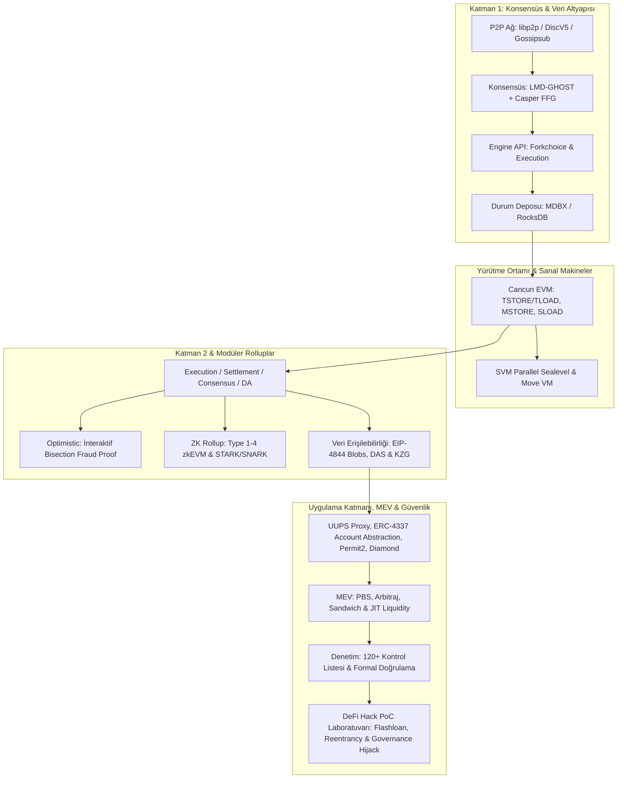

# ⚡ Ultimate Blockchain & Protocol Engineering Compendium

[](LICENSE)
[](https://getfoundry.sh/)
[](https://www.rust-lang.org/)
[](https://soliditylang.org/)
[](https://eips.ethereum.org/)
[](CONTRIBUTING.md)

Bu depo; Web3 alanına adım atan bir bilgisayar bilimcisini **protokol mühendisliği**, **kriptografik altyapılar**, **akıllı sözleşme mimarileri**, **dağıtık konsensüs mekanizmaları**, **istemci mühendisliği** ve **saldırı/savunma teknikleri** konusunda en üst düzeye ulaştırmak; alandaki kıdemli mühendislere ve araştırmacılara ise doğrudan üretim seviyesinde mimari, denetim (audit) ve PoC referansı sunmak için tasarlanmış uçtan uca teknik bir rehberdir.

---

## 🏛️ Kapsamlı Protokol Mimarisi



---

## 📌 İçindekiler
1. [Öğrenim & Çalışma Rotaları (Learning Tracks)](#-öğrenim--çalışma-rotaları-learning-tracks)
2. [Modül 1: Kriptografik Temeller & Matematik](#-modül-1-kriptografik-temeller--matematik)
3. [Modül 2: Dağıtık Sistemler, Ağ Katmanı & Konsensüs](#-modül-2-dağıtık-sistemler-ağ-katmanı--konsensüs)
4. [Modül 3: Sanal Makineler (EVM, SVM, Move VM)](#-modül-3-sanal-makineler-evm-svm-move-vm)
5. [Modül 4: Akıllı Sözleşme Geliştirme & Gas Optimizasyonu](#-modül-4-akıllı-sözleşme-geliştirme--gas-optimizasyonu)
6. [Modül 5: L2, Rollup Mimarileri & Modüler Blockchain](#-modül-5-l2-rollup-mimarileri--modüler-blockchain)
7. [Modül 6: Güvenlik, Denetim (Audit) & Formal Doğrulama](#-modül-6-güvenlik-denetim-audit--formal-doğrulama)
8. [Modül 7: MEV, Mempool Mühendisliği & Node Operasyonu](#-modül-7-mev-mempool-mühendisliği--node-operasyonu)
9. [Modül 8: DeFi Hack PoC Laboratuvarı](#-modül-8-defi-hack-poc-laboratuvarı)
10. [Modül 9: Üretim Ortamı Kontrol Listesi (Mainnet Readiness Checklist)](#-modül-9-üretim-ortamı-kontrol-listesi-mainnet-readiness-checklist)
11. [Modül 10: İstemci Mühendisliği, Depolama Motorları & Node Operasyonu](#-modül-10-istemci-mühendisliği-depolama-motorları--node-operasyonu)

---

## 🧭 Öğrenim & Çalışma Rotaları (Learning Tracks)

*   **Rota A: Akıllı Sözleşme & Protokol Geliştiricisi (Smart Contract Track)**
    *   *Sıra:* [Modül 1](./modules/01-cryptography/) (Hash & İmzalar) $\rightarrow$ [Modül 3](./modules/03-virtual-machines/) (EVM/SVM) $\rightarrow$ [Modül 4](./modules/04-smart-contract-patterns/) (Foundry/ERC-4337/Yul) $\rightarrow$ [Modül 6](./modules/06-security-audit-formal-verification/) (Audit & Fuzzing).
    *   *Hedef:* Yüksek güvenlikli, optimize edilmiş DeFi ve altyapı sözleşmeleri yazmak.
*   **Rota B: Çekirdek Protokol & L2 Mühendisi (Core Protocol Track)**
    *   *Sıra:* [Modül 1](./modules/01-cryptography/) (Tamamı) $\rightarrow$ [Modül 2](./modules/02-distributed-systems-consensus/) (P2P & Konsensüs) $\rightarrow$ [Modül 5](./modules/05-layer2-modular-rollups/) (Rolluplar & ZK) $\rightarrow$ [Modül 10](./modules/10-client-engineering-node-ops/) (Client/Node geliştirme).
    *   *Hedef:* Reth/Geth gibi istemciler geliştirmek, sequencer/prover yazmak, L2 zincirleri kurmak.
*   **Rota C: Güvenlik Araştırmacısı (Security & Auditor Track)**
    *   *Sıra:* [Modül 3](./modules/03-virtual-machines/) (EVM/Yul) $\rightarrow$ [Modül 4](./modules/04-smart-contract-patterns/) (Assembly & Storage) $\rightarrow$ [Modül 6](./modules/06-security-audit-formal-verification/) (Vulnerability Vectors & Formal Verification) $\rightarrow$ [Modül 8](./modules/08-defi-hack-pocs/) (DeFi PoC Laboratuvarı).
    *   *Hedef:* Protokol seviyesinde denetim (audit) yapmak, beyaz şapkalı güvenlik ödülleri (bug bounty) kovalamak.

---

## 🔐 Modül 1: Kriptografik Temeller & Matematik
📁 **Detaylı Rehber ve Kodlar:** [`modules/01-cryptography/`](./modules/01-cryptography/)

*   **Eliptik Eğri Kriptografisi (ECC):**
    *   Sonlu alanlar (Finite Fields) ve grup teorisi temelleri.
    *   `secp256k1` (Bitcoin, Ethereum), `Ed25519` (Solana) matematiği.
    *   BLS12-381 pairing-friendly eğrileri ve eşleşme tabanlı kriptografi.
*   **İmza Şemaları:**
    *   ECDSA, EdDSA, Schnorr İmzaları (Taproot mekanizması).
    *   BLS İmzaları ve imza birleştirme (Signature Aggregation).
*   **Doğrulama & Veri Ağaçları:**
    *   Merkle Trees ve Merkle Proof üretimi.
    *   Verkle Trees: 256-ary vektör taahhütleri ve $O(1)$ boyutlu stateless ispatlar.
    *   Kate-Zaverucha-Goldberg (KZG) Polinom Taahhütleri.
*   **Sıfır Bilgi İspatları (Zero-Knowledge Proofs - ZKP):**
    *   Etkileşimli ve Etkileşimsiz Argümanlar (SNARK vs STARK).
    *   Aritmetizasyon: R1CS, Plonkish Arithmetization, AIR.
*   💻 **Çalıştırılabilir Kodlar:**
    *   [`secp256k1_ecdsa_demo.py`](./modules/01-cryptography/secp256k1_ecdsa_demo.py): Sıfırdan sonlu alan ve ECDSA motoru.
    *   [`bls_signature_aggregation.py`](./modules/01-cryptography/bls_signature_aggregation.py): Ethereum Beacon Chain BLS imza birleştirme motoru.
    *   [`verkle_tree_simulator.py`](./modules/01-cryptography/verkle_tree_simulator.py): 256-ary Verkle tree ve stateless tanık (witness) sıkıştırma simülatörü.
    *   [`merkle_tree.py`](./modules/01-cryptography/merkle_tree.py): OpenZeppelin uyumlu Merkle tree ve audit proof motoru.
    *   [`kzg_polynomial_commitment.py`](./modules/01-cryptography/kzg_polynomial_commitment.py): KZG taahhüt ve açılış ispatı simülatörü.

---

## 🌐 Modül 2: Dağıtık Sistemler, Ağ Katmanı & Konsensüs
📁 **Detaylı Rehber ve Kodlar:** [`modules/02-distributed-systems-consensus/`](./modules/02-distributed-systems-consensus/)

*   **Ağ Katmanı & P2P İletişim:**
    *   Kademlia Dağıtık Hash Tabloları (DHT) ve XOR metriği.
    *   `libp2p` protokol ailesi, DiscV5 (Node Discovery Protocol).
    *   Gossipsub v1.1 mekaniği, peer scoring ve mesaj yayılım gecikmeleri.
*   **Konsensüs Mekanizmaları:**
    *   Nakamoto Consensus (Proof of Work, Fork-choice kuralları, Longest-chain rule).
    *   Klasik Bizans Hata Toleransı (PBFT, Tendermint / CometBFT).
    *   Modern Hibrit Konsensüs: Ethereum PoS (LMD-GHOST + Casper FFG - Gasper mimarisi).
*   💻 **Çalıştırılabilir Kodlar:**
    *   [`gossipsub_network_sim.py`](./modules/02-distributed-systems-consensus/gossipsub_network_sim.py): 100 düğümlü Gossipsub mesh simülasyonu.
    *   [`casper_ffg_lmd_ghost_sim.py`](./modules/02-distributed-systems-consensus/casper_ffg_lmd_ghost_sim.py): Gasper konsensüs, LMD-GHOST head ve FFG kesinleşme motoru.

---

## ⚙️ Modül 3: Sanal Makineler (EVM, SVM, Move VM)
📁 **Detaylı Rehber ve Kodlar:** [`modules/03-virtual-machines/`](./modules/03-virtual-machines/)

*   **Ethereum Virtual Machine (EVM) Derinlemesine:**
    *   256-bit yığın tabanlı (stack-based) mimari sınırları.
    *   Stack, Memory, Storage, Calldata ve Transient Storage (`TSTORE`/`TLOAD` - EIP-1153 Cancun).
    *   Memory quadratic expansion formülü: $\text{Cost}(a) = 3a + \lfloor a^2 / 512 \rfloor$.
    *   Storage Layout: Packed slots, bitmap dizilimleri, mapping/array çakışma riskleri.
*   **Solana Sealevel (SVM):**
    *   Account-based veri modeli (State ve kodun ayrılması).
    *   Önceden bildirilen okuma/yazma kilitleri ile donanım düzeyinde paralel yürütme.
*   **Move Sanal Makinesi (Move VM):**
    *   Doğrusal Mantık (Linear Logic) ve Kaynak Odaklı Programlama.
*   💻 **Referans Sözleşmeler & Kodlar:**
    *   [`svm_parallel_runtime_sim.py`](./modules/03-virtual-machines/svm_parallel_runtime_sim.py): Solana Sealevel paralel işlem çatışma tespiti ve çok çekirdekli yürütme simülatörü.
    *   [`TransientStorageReentrancyGuard.sol`](./modules/03-virtual-machines/contracts/TransientStorageReentrancyGuard.sol): 100 gas maliyetli EIP-1153 reentrancy kilidi.
    *   [`YulMinimalERC20.sol`](./modules/03-virtual-machines/contracts/YulMinimalERC20.sol): Saf Yul Assembly ile yazılmış ultra-optimize ERC-20.
    *   [`StoragePackingDemo.sol`](./modules/03-virtual-machines/contracts/StoragePackingDemo.sol): Storage packing ve bitmap bitwise operasyonları.

---

## 🛠️ Modül 4: Akıllı Sözleşme Geliştirme & Gas Optimizasyonu
📁 **Detaylı Rehber ve Kodlar:** [`modules/04-smart-contract-patterns/`](./modules/04-smart-contract-patterns/)

*   **Geliştirme Araç Seti & Standartlar:**
    *   **Foundry:** `forge` (hızlı test/derleme), `cast` (RPC etkileşimi), `anvil` (yerel node).
    *   **ERC-4337 Account Abstraction:** Akıllı cüzdanlar, `validateUserOp`, paymaster gas sponsorluğu ve 2D nonceler.
    *   **Uniswap Permit2:** İmza tabanlı izinler, süreli yetkilendirmeler ve front-running koruması.
*   **Sözleşme Yükseltilebilirlik Kalıpları (Upgradability):**
    *   Transparent Upgradeable Proxy vs Universal Upgradeable Proxy Standard (UUPS - ERC-1822).
    *   Minimal Proxy Standardı (EIP-1167) 45-baytlık klon mimarisi.
    *   ERC-2535 Diamond Standard ve Diamond Storage deseni.
*   💻 **Referans Sözleşmeler:**
    *   [`ERC4337AccountAbstraction.sol`](./modules/04-smart-contract-patterns/contracts/ERC4337AccountAbstraction.sol): Üretim seviyesi ERC-4337 akıllı hesap sözleşmesi.
    *   [`Permit2Integration.sol`](./modules/04-smart-contract-patterns/contracts/Permit2Integration.sol): Uniswap Permit2 entegrasyonu ve sıfır-onaylı fon yatırma.
    *   [`UUPSUpgradeableVault.sol`](./modules/04-smart-contract-patterns/contracts/UUPSUpgradeableVault.sol): Üretim seviyesi UUPS kasası ve storage gap rezervi.
    *   [`MinimalProxyFactory.sol`](./modules/04-smart-contract-patterns/contracts/MinimalProxyFactory.sol): EIP-1167 CREATE/CREATE2 minimal klon fabrikası.
    *   [`DiamondStoragePattern.sol`](./modules/04-smart-contract-patterns/contracts/DiamondStoragePattern.sol): Çakışmasız modüler diamond storage yapısı.

---

## 🏗️ Modül 5: L2, Rollup Mimarileri & Modüler Blockchain
📁 **Detaylı Rehber ve Kodlar:** [`modules/05-layer2-modular-rollups/`](./modules/05-layer2-modular-rollups/)

*   **Rollup Temelleri & Görev Ayrımı:**
    *   Execution, Settlement, Consensus ve Data Availability ayrımı.
*   **Optimistic Rollups:**
    *   Fraud Proof (Sahtekarlık İspatı) sistemleri.
    *   Tek turlu vs Çok turlu interaktif iki taraflı bölme (Interactive Bisection).
    *   OP Stack mimarisi (`op-node`, `op-geth`, Cannon VM) ve Arbitrum Nitro.
*   **Zero-Knowledge (ZK) Rollups:**
    *   Validity Proof üretimi ve on-chain doğrulama maliyetleri.
    *   Vitalik Buterin'in 4 seviyeli zkEVM taksonomisi (Type 1'den Type 4'e).
*   **Veri Erişilebilirliği (Data Availability - DA):**
    *   Proto-Danksharding (EIP-4844) Blob Space ve KZG point evaluation precompile `0x0a`.
    *   Data Availability Sampling (DAS) ve 2D Reed-Solomon silinti kodlaması (Erasure Coding).
*   💻 **Çalıştırılabilir Kodlar:**
    *   [`interactive_fraud_proof_bisection.py`](./modules/05-layer2-modular-rollups/interactive_fraud_proof_bisection.py): $O(\log N)$ adımlı interaktif sahtekarlık ispatı simülatörü.
    *   [`das_erasure_coding_sim.py`](./modules/05-layer2-modular-rollups/das_erasure_coding_sim.py): 2D Reed-Solomon Data Availability Sampling (DAS) hafif düğüm simülatörü.
    *   [`blob_gas_calculator.py`](./modules/05-layer2-modular-rollups/blob_gas_calculator.py): EIP-4844 blob gas fiyatı ve calldata karşılaştırma motoru.

---

## 🛡️ Modül 6: Güvenlik, Denetim (Audit) & Formal Doğrulama
📁 **Detaylı Rehber ve Kodlar:** [`modules/06-security-audit-formal-verification/`](./modules/06-security-audit-formal-verification/)

*   **En Kritik Açık Vektörleri:**
    *   Reentrancy: Single-function, Cross-function ve Cross-contract Read-only Reentrancy.
    *   DeFi Matematik Hataları: Precision loss, rounding direction hataları, strict equality (`==`) riskleri.
    *   Fiyat Manipülasyonları: Spot DEX havuzlarından fiyat çekme, AMM TWAP süresi manipülasyonları.
    *   Erişim Kontrolü (Access Control): Missing modifier, uninitialized logic contracts.
*   **Statik & Dinamik Güvenlik Araçları:**
    *   Statik Analiz: Slither, Aderyn (Rust tabanlı AST analizcisi).
    *   Fuzzing: Echidna, Medusa, Foundry invariant testing.
    *   Formal Doğrulama (Formal Verification): Certora Prover (CVL), Halmos ve SMTChecker.
*   💻 **Referans Dosyalar:**
    *   [`AUDIT_CHECKLIST.md`](./modules/06-security-audit-formal-verification/AUDIT_CHECKLIST.md): 120+ maddelik kapsamlı akıllı sözleşme denetim kontrol listesi.
    *   [`Certora_Spec_Example.cvl`](./modules/06-security-audit-formal-verification/Certora_Spec_Example.cvl): Solvency kuralları formal spesifikasyon dosyası.
    *   [`Halmos_Formal_Verification_Test.sol`](./modules/06-security-audit-formal-verification/Halmos_Formal_Verification_Test.sol): Halmos sembolik test şablonu.

---

## ⚡ Modül 7: MEV, Mempool Mühendisliği & Node Operasyonu
📁 **Detaylı Rehber ve Kodlar:** [`modules/07-mev-mempool-engineering/`](./modules/07-mev-mempool-engineering/)

*   **Maximal Extractable Value (MEV):**
    *   Searcher, Builder, Relay ve Proposer (Validator) ekosistemi.
    *   PBS (Proposer-Builder Separation) mimarisi ve MEV-Boost protokolü.
    *   Arbitraj, Sandwich Attacks, Tasfiye ve JIT likidite stratejileri.
*   **Mempool Dinamikleri:**
    *   P2P Transaction propagation, txpool yönetimi ve Priority Gas Auctions (PGA).
    *   Özel RPC sistemleri: Flashbots Protect, MEV-Share, SUAVE.
*   💻 **Çalıştırılabilir Kodlar:**
    *   [`bellman_ford_arbitrage.py`](./modules/07-mev-mempool-engineering/bellman_ford_arbitrage.py): Havuzlar arası negatif döngü arayan Bellman-Ford çapraz-DEX arbitraj motoru.
    *   [`sandwich_attack_sim.py`](./modules/07-mev-mempool-engineering/sandwich_attack_sim.py): Optimal front-run/back-run boyutu hesaplayan ve kâr realize eden sandwich simülatörü.
    *   [`jit_liquidity_simulator.py`](./modules/07-mev-mempool-engineering/jit_liquidity_simulator.py): Uniswap v3 Just-In-Time (JIT) likidite MEV saldırısı simülatörü.

---

## 💥 Modül 8: DeFi Hack PoC Laboratuvarı
📁 **Detaylı Rehber ve Kodlar:** [`modules/08-defi-hack-pocs/`](./modules/08-defi-hack-pocs/)

*   **Gerçek Dünyadan İstismar Simülasyonları:**
    *   **Euler Finance Tarzı Read-Only Reentrancy:** AMM havuzunun ara durumundaki sanal fiyat bozulmasıyla kredi protokolünü boşaltma.
    *   **Flash Loan Spot Fiyat Manipülasyonu:** Anlık rezervleri bozan saldırganın teminatsız kredi çekerek hazineyi soyması.
    *   **ERC-4626 İlk Yatıran Enflasyon Saldırısı:** 1 wei yatırıp büyük bağış yaparak sonraki kullanıcıların paylarını sıfıra yuvarlama ve paralarını çalma.
    *   **Beanstalk Tarzı Flash Loan Yönetişim Darbesi (Governance Hijack):** Anlık oylarla hazineyi boşaltma ve ERC20Votes kontrol noktası savunması.
*   💻 **Referans Sözleşmeler:**
    *   [`ReadOnlyReentrancyPoC.sol`](./modules/08-defi-hack-pocs/contracts/ReadOnlyReentrancyPoC.sol): Savunmasız havuz, istismar senaryosu ve Cancun transient lock ile düzeltilmiş havuz.
    *   [`FlashLoanPriceManipulationPoC.sol`](./modules/08-defi-hack-pocs/contracts/FlashLoanPriceManipulationPoC.sol): Spot fiyat açığı ve TWAP oracle savunması.
    *   [`ERC4626InflationAttackPoC.sol`](./modules/08-defi-hack-pocs/contracts/ERC4626InflationAttackPoC.sol): Enflasyon saldırısı ve sanal pay (virtual shares) savunması.
    *   [`GovernanceFlashLoanHijackPoC.sol`](./modules/08-defi-hack-pocs/contracts/GovernanceFlashLoanHijackPoC.sol): Flash loan yönetişim saldırısı ve `getPastVotes` geçmiş blok kontrol noktası savunması.

---

## 🚀 Modül 9: Üretim Ortamı Kontrol Listesi (Mainnet Readiness Checklist)
📁 **Detaylı Rehber:** [`modules/09-production-checklist/MAINNET_READINESS_CHECKLIST.md`](./modules/09-production-checklist/MAINNET_READINESS_CHECKLIST.md)

12 aşamalı ana ağa çıkış kontrol listesi:
1. Mimari & Tehdit Modellemesi Onayı
2. Test Kapsamı ($> 95\%$) & Invariant Fuzzing
3. Bağımsız Güvenlik Denetimleri & Rekabetçi Audit Yarışmaları
4. Formal Doğrulama (Certora / Halmos)
5. Dağıtım Scriptleri & CREATE2 Deterministik Adresleme
6. Safe Multisig & TimelockController Entegrasyonu
7. Acil Durum Duraklatma (Pausable) & Devre Kesiciler
8. Oracle Güvenliği, Yedekleme & L2 Sequencer Kontrolleri
9. Canlı İzleme & Tehdit Tespiti (Forta / Tenderly)
10. Bug Bounty Programı (Immunefi)
11. Likidite Başlatma & MEV/Slippage Korumaları
12. Dağıtım Sonrası Doğrulama ve Şeffaflık

---

## 🖥️ Modül 10: İstemci Mühendisliği, Depolama Motorları & Node Operasyonu
📁 **Detaylı Rehber ve Kodlar:** [`modules/10-client-engineering-node-ops/`](./modules/10-client-engineering-node-ops/)

*   **Execution Layer (EL) vs Consensus Layer (CL):**
    *   İstemci mimarileri: Reth (Rust), Geth (Go), Nethermind (C#), Lighthouse, Prysm.
    *   Durum Depolama Motorları: MDBX (B+ Tree, zero-copy `mmap`) vs RocksDB (LSM-Tree).
*   **Engine API Protokolü:**
    *   `8551` portu üzerinden HMAC-SHA256 JWT yetkilendirmesi.
    *   `engine_forkchoiceUpdatedV3`, `engine_newPayloadV3`, `engine_getPayloadV3` yürütme döngüsü.
*   **Düğüm Senkronizasyonu:**
    *   Snap Sync, Full Archive Node, Stateless Node modelleri.
*   💻 **Çalıştırılabilir Kodlar:**
    *   [`engine_api_rpc_mock.py`](./modules/10-client-engineering-node-ops/engine_api_rpc_mock.py): JWT HS256 kimlik doğrulamalı ve forkchoice yürütmeli Engine API mock sunucusu.

---

## 📦 Kurulum ve Çalıştırma

```bash
# Depoyu klonlayın
git clone https://github.com/bahattinyunus/Ultimate-Blockchain-Protocol-Engineering-Compendium.git
cd Ultimate-Blockchain-Protocol-Engineering-Compendium

# Kriptografi simülatörlerini çalıştırın
python modules/01-cryptography/secp256k1_ecdsa_demo.py
python modules/01-cryptography/bls_signature_aggregation.py
python modules/01-cryptography/verkle_tree_simulator.py
python modules/01-cryptography/merkle_tree.py
python modules/01-cryptography/kzg_polynomial_commitment.py

# Konsensüs, P2P ve Sanal Makine simülatörlerini çalıştırın
python modules/02-distributed-systems-consensus/gossipsub_network_sim.py
python modules/02-distributed-systems-consensus/casper_ffg_lmd_ghost_sim.py
python modules/03-virtual-machines/svm_parallel_runtime_sim.py

# L2 ve Rollup simülatörlerini çalıştırın
python modules/05-layer2-modular-rollups/interactive_fraud_proof_bisection.py
python modules/05-layer2-modular-rollups/das_erasure_coding_sim.py
python modules/05-layer2-modular-rollups/blob_gas_calculator.py

# MEV motorlarını çalıştırın
python modules/07-mev-mempool-engineering/bellman_ford_arbitrage.py
python modules/07-mev-mempool-engineering/sandwich_attack_sim.py
python modules/07-mev-mempool-engineering/jit_liquidity_simulator.py

# Engine API & İstemci simülatörünü çalıştırın
python modules/10-client-engineering-node-ops/engine_api_rpc_mock.py
```

---

## 📄 Lisans
Bu proje [MIT Lisansı](./LICENSE) altında açık kaynak olarak sunulmaktadır.
