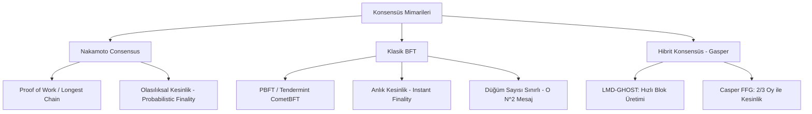

# Modül 2: Dağıtık Sistemler, Ağ Katmanı & Konsensüs (Distributed Systems & Consensus)

Bu modül, merkeziyetsiz düğümlerin (nodes) P2P ağlarda nasıl iletişim kurduğunu, mesajların nasıl yayıldığını (gossip), çekişmeli durumlarda hangi zincirin doğru kabul edildiğini (fork choice) ve ekonomik kesinliğin (economic finality) nasıl sağlandığını irdeler.

---

## 📌 İçindekiler
1. [P2P Ağ Mimarisi: libp2p, Kademlia DHT ve Gossipsub](#1-p2p-ağ-mimarisi-libp2p-kademlia-dht-ve-gossipsub)
2. [Konsensüs Mekanizmaları Karşılaştırması](#2-konsensüs-mekanizmaları-karşılaştırması)
3. [Ethereum Gasper Mimarisi (LMD-GHOST + Casper FFG)](#3-ethereum-gasper-mimarisi-lmd-ghost--casper-ffg)
4. [Client Mimarisi & Engine API](#4-client-mimarisi--engine-api)
5. [Yüksek Performanslı Depolama: MDBX vs RocksDB](#5-yüksek-performanslı-depolama-mdbx-vs-rocksdb)
6. [Simülatörler](#6-simülatörler)

---

## 1. P2P Ağ Mimarisi: libp2p, Kademlia DHT ve Gossipsub

Modern blokzincir düğümleri merkezi bir sunucu olmadan birbiriyle konuşur:
- **Kademlia DHT:** Düğümler 160/256 bitlik ID uzayında XOR metriği ile ($d(x,y) = x \oplus y$) adreslenir. $O(\log N)$ sıçrama ile hedef düğüm bulunur.
- **DiscV5 (Discovery v5):** Ethereum'un UDP tabanlı komşu arama protokolü. ENR (Ethereum Node Records) imzalı metaverileri taşır.
- **Gossipsub v1.1:**
  - **Mesh:** Her konu (topic) için $D$ adet eşten (örneğin $D_{low}=6, D=8, D_{high}=12$) oluşan dinamik bir ağ örgüsü.
  - **Peer Scoring:** Kötü niyetli, geç kalan veya spam üreten düğümlere negatif skor atanır ve ağdan izole edilir.
  - **Control Messages:** `IHAVE` ve `IWANT` mesajları sayesinde doğrudan mesh içinde olmayan eşlere de veri özeti fısıldanır.

---

## 2. Konsensüs Mekanizmaları Karşılaştırması

---

## 3. Ethereum Gasper Mimarisi (LMD-GHOST + Casper FFG)

1. **LMD-GHOST (Fork Choice):**
   - Her düğümün en son gözlemlediği oylara (Latest Message Driven) göre en ağır alt ağacı (Greediest Heaviest Observed SubTree) seçer.
   - Ağ gecikmesi veya çatallanma (fork) anlarında dahi anında bir sonraki bloğu seçecek kuralı tanımlar.

2. **Casper FFG (Finality Gadget):**
   - 32 slot = 1 Epoch (~6.4 dakika).
   - Bir checkpoint (epoch sınırındaki blok), validatörlerin toplam hissesinin $2/3$'ünden fazlasının oyuyla **Justified** (gerekçeli) hale gelir.
   - Ardışık iki justified checkpoint oluştuğunda ilki **Finalized** (kesinleşmiş) olur.
   - Kesinleşen bir bloğu geri almak, toplam stake'in en az $\%33.3$'ünün yakılmasını (slashing) gerektirir.

---

## 4. Client Mimarisi & Engine API

Ethereum PoS sonrası düğüm iki bağımsız katmana ayrılmıştır:
- **Consensus Layer (CL):** Prysm, Lighthouse, Teku, Lodestar (Konsensüs, slot/epoch zamanlaması, P2P blok teklifi).
- **Execution Layer (EL):** Reth, Geth, Nethermind, Besu (EVM yürütme, state trie, mempool yönetimi).
- **Engine API (JSON-RPC over Auth Token):**
  - `engine_forkchoiceUpdated`: CL, EL'e mevcut en iyi baş bloğu ve kesinleşmiş bloğu bildirir.
  - `engine_newPayload`: CL, ağdan aldığı yürütme bloğunu EL'e doğrulaması için gönderir.
  - `engine_getPayload`: CL, bloğun inşa edilmesini EL'den ister (MEV veya yerel blok).

---

## 5. Yüksek Performanslı Depolama: MDBX vs RocksDB

Reth gibi yeni nesil Rust istemcileri **libmdbx** kullanmaktadır:
- **RocksDB (LSM-Tree):** Yazma odaklı (write-heavy). Compaction gecikmeleri ve read-amplification dezavantajı vardır.
- **MDBX (B+ Tree / LMDB türevi):** Okuma odaklı (read-heavy), sıfır kopyalama (zero-copy), bellek haritalı dosya erişimi (`mmap`). State okumalarında EVM yürütmesini devasa oranda hızlandırır.

---

## 6. Simülatörler

- [`gossipsub_network_sim.py`](./gossipsub_network_sim.py): Düğümler arası mesh bağlantıları, gossip yayılımı ve gecikme dağılımını simüle eder.
- [`casper_ffg_lmd_ghost_sim.py`](./casper_ffg_lmd_ghost_sim.py): Epoch bazlı 2/3 süper-çoğunluk Casper FFG kesinleşmesini ve LMD-GHOST fork-choice baş blok seçimini simüle eder.
