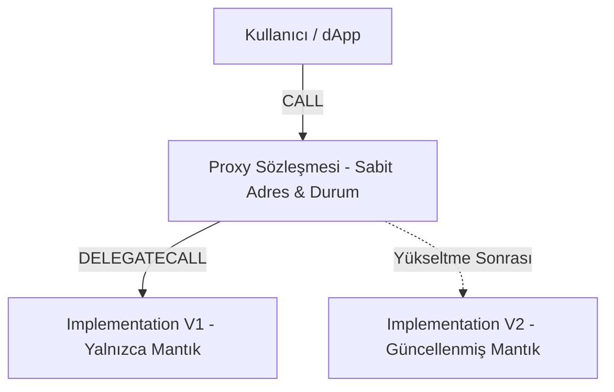

# Modül 4: Akıllı Sözleşme Geliştirme & Gas Optimizasyonu (Smart Contract Engineering & Gas Patterns)

Bu modül, üretim seviyesindeki akıllı sözleşme mimarilerini, proxy yükseltilebilirlik modellerini (ERC-1967, UUPS, Diamond), minimal klonlama tekniklerini (ERC-1167) ve ileri seviye gaz optimizasyon tekniklerini kapsar.

---

## 📌 İçindekiler
1. [Sözleşme Yükseltilebilirlik Modelleri (Proxy Patterns)](#1-sözleşme-yükseltilebilirlik-modelleri-proxy-patterns)
2. [EIP-1167 Minimal Proxy (Clones) Mimarisi](#2-eip-1167-minimal-proxy-clones-mimarisi)
3. [ERC-2535 Diamond Pattern ve Diamond Storage](#3-erc-2535-diamond-pattern-ve-diamond-storage)
4. [İleri Düzey Gaz Optimizasyon Teknikleri](#4-ileri-düzey-gaz-optimizasyon-teknikleri)
5. [Referans Akıllı Sözleşmeler](#5-referans-akıllı-sözleşmeler)

---

## 1. Sözleşme Yükseltilebilirlik Modelleri (Proxy Patterns)



### Transparent vs UUPS (Universal Upgradeable Proxy Standard)
- **Transparent Proxy:** Yükseltme mantığı Proxy kontratının kendisinde veya bir ProxyAdmin sözleşmesinde bulunur. Her çağrıda `caller == admin` kontrolü yapılır; bu durum fazladan gas harcatır ve "Function Clashing" riskini önlemek için karmaşık yönlendirme gerektirir.
- **UUPS (ERC-1822):** Yükseltme mantığı (`upgradeToAndCall`) **Implementation** sözleşmesine gömülüdür. Proxy son derece hafif ve ucuzdur. Yükseltme yetkisi kontrolü doğrudan implementation sözleşmesinde yapılır.
- **ERC-1967 Standart Slotları:**
  - Implementation Slot: `bytes32(uint256(keccak256('eip1967.proxy.implementation')) - 1)`
  - Admin Slot: `bytes32(uint256(keccak256('eip1967.proxy.admin')) - 1)`

---

## 2. EIP-1167 Minimal Proxy (Clones) Mimarisi

Bir sözleşmeyi yüzlerce kez `new Contract()` ile dağıtmak çok yüksek gaz maliyeti doğurur. EIP-1167, yalnızca 45 baytlık statik bayt kodu kullanarak ana sözleşmeyi `delegatecall` ile yönlendiren minimal klonlar üretir:

```
363d3d373d3d3d363d73 <20-byte implementation address> 5af43d82803e903d91602b57fd5bf3
```

Klon oluşturma maliyeti ~45,000 gas'a düşer (klasik deploy ~1,000,000+ gas).

---

## 3. ERC-2535 Diamond Pattern ve Diamond Storage

Tek bir sözleşmenin 24 KB bayt kodu sınırına (Spurious Dragon / EIP-170) takılmasını önlemek için:
- **Facets (Yüzler):** Mantık bağımsız sözleşmelere (yüzlere) bölünür.
- **Diamond Storage:** Her modül kendi state'ini benzersiz bir keccak256 slotunda saklar:
  ```solidity
  bytes32 constant VAULT_STORAGE_POSITION = keccak256("vault.diamond.storage");
  ```
  Bu yöntem inheritance (kalıtım) kaynaklı storage collision (çakışma) riskini tamamen ortadan kaldırır.

---

## 4. İleri Düzey Gaz Optimizasyon Teknikleri

| Optimizasyon Tekniği | Tipik Gas Tasarrufu | Mekanizma |
| :--- | :--- | :--- |
| **Custom Errors (`error`)** | 2,000 - 5,000 gas | `require(c, "string")` string depolamak yerine 4-baytlık hata seçicisi fırlatır. |
| **`calldata` vs `memory`** | 1,000+ gas | Harici fonksiyon argümanlarında bayt kopyalamayı önler, doğrudan calldata'dan okur. |
| **Slot Packing & Bitmap** | 20,000 gas / slot | Değişkenleri 32 bayta paketler, çoklu SSTORE yerine tek SSTORE yapar. |
| **`unchecked { ++i; }`** | 30 - 40 gas / döngü | Taşma riski olmayan sayaçlarda gereksiz SafeMath kontrolünü devre dışı bırakır. |
| **Transient Storage (`tstore`)** | 2,000+ gas | Reentrancy guard gibi tek işlemde başlayıp biten durumlarda 2100 gas yerine 100 gas harcar. |

---

## 5. Referans Akıllı Sözleşmeler

- [`contracts/UUPSUpgradeableVault.sol`](./contracts/UUPSUpgradeableVault.sol): ERC-1967 uyumlu, storage-gap korumalı UUPS vault implementasyonu.
- [`contracts/MinimalProxyFactory.sol`](./contracts/MinimalProxyFactory.sol): EIP-1167 minimal proxy klonlama motoru.
- [`contracts/DiamondStoragePattern.sol`](./contracts/DiamondStoragePattern.sol): Diamond storage deseni ve çakışmasız durum saklama yapısı.
