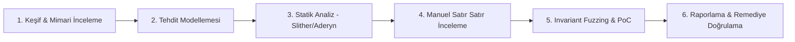

# Modül 6: Güvenlik, Denetim (Audit) & Formal Doğrulama (Security, Auditing & Formal Verification)

Bu modül, akıllı sözleşme denetim metodolojisini, en ölümcül saldırı vektörlerini, fuzz test pratiklerini ve matematiksel kesinlik sunan formal doğrulama (formal verification) tekniklerini inceler.

---

## 📌 İçindekiler
1. [Akıllı Sözleşme Denetim Metodolojisi](#1-akıllı-sözleşme-denetim-metodolojisi)
2. [En Kritik Zafiyet Vektörleri Matrisi](#2-en-kritik-zafiyet-vektörleri-matrisi)
3. [Otomatize Araçlar: Statik Analiz & Fuzzing](#3-otomatize-araçlar-statik-analiz--fuzzing)
4. [Formal Doğrulama (Certora & Halmos)](#4-formal-doğrulama-certora--halmos)
5. [Kapsamlı Audit Kontrol Listesi ve Dosyalar](#5-kapsamlı-audit-kontrol-listesi-ve-dosyalar)

---

## 1. Akıllı Sözleşme Denetim Metodolojisi

Profesyonel bir denetim 6 ardışık aşamadan oluşur:

---

## 2. En Kritik Zafiyet Vektörleri Matrisi

| Zafiyet Kategorisi | Açıklama | Tipik İstismar Senaryosu | Çözüm / Savunma |
| :--- | :--- | :--- | :--- |
| **Read-Only Reentrancy** | Salt-okunur fonksiyonlar (`get_virtual_price`) reentrancy kilidiyle korunmadığında ara durumda yanlış veri üretir. | Curve LP token fiyatı manipüle edilerek borç verme protokolü boşaltılır. | Fiyat hesaplayan `view` fonksiyonlarına da transient lock veya reentrancy kontrolü eklemek. |
| **Spot DEX Oracle Manipülasyonu** | Fiyatın doğrudan anlık AMM rezervlerinden okunması ($x \cdot y = k$). | Flashloan ile havuz dengesi bozulur, teminatsız kredi çekilir. | Chainlink oracles + Uniswap v3 TWAP (en az 30 dakika) + Medyan filtreleme. |
| **Precision Loss / Inflation Attack** | ERC-4626 kasalarında ilk kullanıcının 1 wei yatırıp arkasından bağış (donation) yapması. | Sonraki kullanıcıların payları yuvarlanarak 0'a iner, fonları çalınır. | Sanal paylar (Virtual Shares & Assets) ve ilk 1000 payın yakılması (Dead Shares). |
| **Erişim Kontrolü ve Uninitialized Logic** | Implementation sözleşmesinde `initialize` çağrılmamış olması. | Saldırgan implementation'ın sahibi olur ve `delegatecall(selfdestruct)` ile proxy'yi dondurur. | Constructor içinde `_disableInitializers()` çağırmak. |
| **İmza Replay (EIP-712 Eksikliği)** | Domain separator (zincir kimliği `chainId`, sözleşme adresi) içermeyen imzalar. | Bir testnet veya çatallanmış zincirdeki imza Mainnet'te yeniden kullanılır. | EIP-712 standart tipik yapısal imzalama ve tekil nonce takibi. |

---

## 3. Otomatize Araçlar: Statik Analiz & Fuzzing

1. **Slither & Aderyn:**
   - Solidity kodunu AST (Abstract Syntax Tree) seviyesinde tarayarak reentrancy, uninitialized state, shadowing ve kilitlenmiş ether durumlarını saniyeler içinde raporlar.
2. **Foundry Invariant Fuzzing:**
   - Sistemin asla ihlal edilmemesi gereken kurallarını (invariants) rastgele üretilen binlerce işlem dizisiyle test eder.
   - Örnek: `assert(vault.totalAssets() >= vault.totalSupply())`.

---

## 4. Formal Doğrulama (Certora & Halmos)

Formal doğrulama, fuzzer'ların aksine "olasılıksal" değil, **tüm olası durum uzayı (infinite state space)** için matematiksel kesinlik sunar.
- **Certora Prover (CVL):** SMT çözücüler (Z3) kullanarak sözleşmenin belirlenen kurallara her koşulda uyup uymadığını teorem ispatı ile doğrular.
- **Halmos:** Foundry test dosyalarını sembolik yürütme motoruyla (symbolic execution) sıfır konfigürasyonla doğrular.

---

## 5. Kapsamlı Audit Kontrol Listesi ve Dosyalar

- [`AUDIT_CHECKLIST.md`](./AUDIT_CHECKLIST.md): 120+ maddelik üretim seviyesi denetim kontrol listesi.
- [`Certora_Spec_Example.cvl`](./Certora_Spec_Example.cvl): Solvency ve kullanıcı bakiyesi formal ispat kuralları.
- [`Halmos_Formal_Verification_Test.sol`](./Halmos_Formal_Verification_Test.sol): Sembolik test şablonu.
