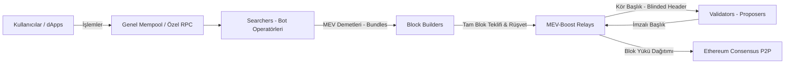

# Modül 7: MEV, Mempool Mühendisliği & Node Operasyonu (MEV & Mempool Engineering)

Bu modül; Maksimal Çıkarılabilir Değer (Maximal Extractable Value - MEV) ekosistemini, PBS (Proposer-Builder Separation) mimarisini, mempool dinamiklerini, özel RPC ve Flashbots altyapılarını ve algoritmik bot stratejilerini inceler.

---

## 📌 İçindekiler
1. [MEV Ekosistemi: Searcher, Builder, Relay, Validator](#1-mev-ekosistemi-searcher-builder-relay-validator)
2. [PBS (Proposer-Builder Separation) & MEV-Boost](#2-pbs-proposer-builder-separation--mev-boost)
3. [Temel MEV Stratejileri](#3-temel-mev-stratejileri)
4. [Mempool Mimarisi ve Özel Sipariş Akışı (Private Order Flow)](#4-mempool-mimarisi-ve-özel-sipariş-akışı-private-order-flow)
5. [Simülatörler ve Algoritmalar](#5-simülatörler-ve-algoritmalar)

---

## 1. MEV Ekosistemi: Searcher, Builder, Relay, Validator

Ethereum PoS mimarisinde MEV akışı şu aktörler arasında gerçekleşir:

- **Searcher:** Arbitraj, sandwich ve tasfiye fırsatlarını arayan, `bundle` (işlem demeti) üreten bağımsız mühendisler.
- **Block Builder:** Searcher'lardan gelen demetleri ve mempool işlemlerini birleştirerek en yüksek kâr getiren bloğu derleyen aktör.
- **Relay:** Builder ile Validator arasında güvenilir aracılık yapan, validatörün bloğu çalmasını engelleyen açık kaynaklı sunucu.
- **Validator (Proposer):** MEV-Boost üzerinden en yüksek teklifi (bid) veren bloğu imzalar ve blok ödülünü alır.

---

## 2. PBS (Proposer-Builder Separation) & MEV-Boost

Validatörlerin kendi sıralama güçlerini kullanarak küçük kullanıcıları istismar etmesini veya merkezileşmesini engellemek için yürütme bloğu inşası ile blok teklif etme birbirinden ayrılmıştır:
- Validatör bloğun içindeki işlemleri göremez (`blinded block`), yalnızca bloğun değerini ve getirisini görür.
- Validatör bloğu imzaladıktan sonra Relay bloğun tüm içeriğini ağa yayınlar.
- Gelecek adım: **ePBS (Enshrined PBS)** ile bu mimarinin doğrudan protokol seviyesine (L1 konsensüsüne) entegre edilmesi planlanmaktadır.

---

## 3. Temel MEV Stratejileri

1. **Atomik Çevrimsel Arbitraj (Atomic Cyclic Arbitrage):**
   - Farklı DEX'lerdeki (ör. Uniswap, Sushiswap, Curve) fiyat uyumsuzluklarını tek bir işlemde tespit edip flashloan ile risksiz kâr sağlama.
2. **Sandwich Saldırıları (Sandwiching):**
   - Yetersiz slippage korumasına sahip büyük bir takas (swap) işleminin önüne (front-run) ve arkasına (back-run) kendi işlemlerini yerleştirerek kullanıcının kayma payından değer çıkarma.
3. **Tasfiye Botları (Liquidation Bots):**
   - Teminat oranı düşen borçluları ilk tasfiye eden olmak için yarışma.
4. **JIT (Just-in-Time) Likidite:**
   - Uniswap v3 havuzunda büyük bir takas gelmeden hemen önce dar aralıkta devasa likidite ekleyip, işlem biter bitmez likiditeyi geri çekme.

---

## 4. Mempool Mimarisi ve Özel Sipariş Akışı (Private Order Flow)

Genel mempool'a (P2P txpool) düşen işlemler halka açıktır ve saniyeler içinde kopyalanıp gas yarışına (Priority Gas Auction - PGA) sokulabilir. Bu nedenle modern dApp'ler ve cüzdanlar özel RPC'ler kullanır:
- **Flashbots Protect:** Kullanıcının işlemini doğrudan builder'lara iletir; genel mempool'a düşürmez, revert olursa gas harcamaz ve sandwich saldırılarını engeller.
- **MEV-Share & MEV-Blocker:** Kullanıcının yarattığı MEV değerinin bir kısmını nakit iade (rebate) olarak kullanıcıya geri öder.

---

## 5. Simülatörler ve Algoritmalar

- [`bellman_ford_arbitrage.py`](./bellman_ford_arbitrage.py): Havuzlar arası döviz kurlarını negatif logaritmik ağırlıklara çevirerek Bellman-Ford ile risksiz arbitraj döngülerini bulan algoritma.
- [`sandwich_attack_sim.py`](./sandwich_attack_sim.py): Uniswap $x \cdot y = k$ formülü üzerinden optimal front-run/back-run boyutu ve sandwich kâr hesaplama simülatörü.
