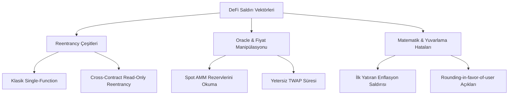

# Modül 8: DeFi Hack PoC Laboratuvarı (DeFi Hack PoC Laboratory)

Bu modül, merkeziyetsiz finans (DeFi) tarihine damga vuran en yıkıcı hack ve istismar olaylarının kök neden analizlerini (root cause analysis) ve Solidity ile yazılmış, yeniden üretilebilir (reproducible) Proof-of-Concept (PoC) sözleşmelerini içerir.

---

## 📌 İçindekiler
1. [DeFi Hack Vektörleri Taksonomisi](#1-defi-hack-vektörleri-taksonomisi)
2. [PoC 1: Read-Only Reentrancy Saldırısı](#2-poc-1-read-only-reentrancy-saldırısı)
3. [PoC 2: Flash Loan Spot Fiyat Manipülasyonu](#3-poc-2-flash-loan-spot-fiyat-manipülasyonu)
4. [PoC 3: ERC-4626 Kasalarında Enflasyon (Donation) Saldırısı](#4-poc-3-erc-4626-kasalarında-enflasyon-donation-saldırısı)
5. [Savunma Mimarileri ve Düzeltmeler](#5-savunma-mimarileri-ve-düzeltmeler)

---

## 1. DeFi Hack Vektörleri Taksonomisi

---

## 2. PoC 1: Read-Only Reentrancy Saldırısı

- **Olay Örneği:** Euler Finance ($197M), Sentiment Protocol.
- **Kök Neden:** Bir AMM veya likidite havuzu (örneğin Curve) fon çekme (`withdraw`) sırasında ETH transferini state güncellemesinden önce veya ara aşamada yapar. Klasik yazma fonksiyonları `nonReentrant` kilidiyle korunmuştur; ancak fiyat hesaplayan `get_virtual_price()` fonksiyonu `view` (salt-okunur) olduğu için kilitli değildir.
- **İstismar Akışı:**
  1. Saldırgan havuzdan fon çeker.
  2. Havuz saldırgana yerel token transfer eder (kontrol saldırgana geçer - `receive()`).
  3. Havuz henüz LP token arzını veya rezervlerini senkronize etmemiştir.
  4. Saldırgan ara durumda kurban protokole gider; kurban protokol havuzun `get_virtual_price()` fonksiyonunu okur.
  5. Fiyat geçici olarak şişmiş görünür; saldırgan bu şişirilmiş fiyattan teminat gösterip tüm fonları borçlanır ve kaçar.
- **Referans Dosya:** [`contracts/ReadOnlyReentrancyPoC.sol`](./contracts/ReadOnlyReentrancyPoC.sol)

---

## 3. PoC 2: Flash Loan Spot Fiyat Manipülasyonu

- **Olay Örneği:** bZx, Harvest Finance, Mango Markets, Cream Finance.
- **Kök Neden:** Bir borç verme protokolünün teminat değerini belirlemek için anlık AMM rezerv oranını ($r_y / r_x$) kullanması.
- **İstismar Akışı:**
  1. Flash loan ile $10,000,000$ USDC borç alınır.
  2. Havuzdaki tüm WETH satın alınarak WETH fiyatı yapay olarak $10\times$ artırılır.
  3. Borç verme protokolüne $100$ WETH teminat yatırılır; protokol bunu $1,000$ WETH değerinde görür.
  4. Teminatın karşılığında protokolün tüm hazinesi (USDC, DAI vb.) borç alınır.
  5. Havuzdaki takas tersine çevrilir, flash loan geri ödenir; borç verme protokolü batık kredi ile baş başa kalır.
- **Referans Dosya:** [`contracts/FlashLoanPriceManipulationPoC.sol`](./contracts/FlashLoanPriceManipulationPoC.sol)

---

## 4. PoC 3: ERC-4626 Kasalarında Enflasyon (Donation) Saldırısı

- **Olay Örneği:** Çok sayıda yeni başlatılan ERC-4626 kasa ve yield vault protokolü.
- **Kök Neden:** Boş bir kasada hisse oranı $\text{shares} = \text{assets} \cdot \frac{\text{totalSupply}}{\text{totalAssets}}$ formülüyle hesaplanır.
- **İstismar Akışı:**
  1. Saldırgan boş kasaya ilk olarak **1 wei** yatırır $\rightarrow$ 1 pay (share) alır.
  2. Saldırgan kasaya doğrudan `transfer` ile $10,000$ token bağışlar (donate).
  3. Artık $1$ pay $= 10,001$ token değerindedir!
  4. Kurban kullanıcı $19,999$ token yatırır.
  5. Kurbanın pay hesabı: $19,999 \cdot \frac{1}{10,001} = 1.999 \dots \rightarrow$ tam sayı bölünmesi nedeniyle **1 pay** alır!
  6. Saldırgan payını yakar (burn) ve kurbanın parasının neredeyse yarısını cebe indirir.
- **Referans Dosya:** [`contracts/ERC4626InflationAttackPoC.sol`](./contracts/ERC4626InflationAttackPoC.sol)

---

## 5. Savunma Mimarileri ve Düzeltmeler

Her PoC sözleşmesi, hem zafiyetli sözleşmeyi, hem saldırgan sözleşmesini, hem de endüstri standardı **düzeltilmiş (mitigated)** sözleşmeyi yan yana içerir.
