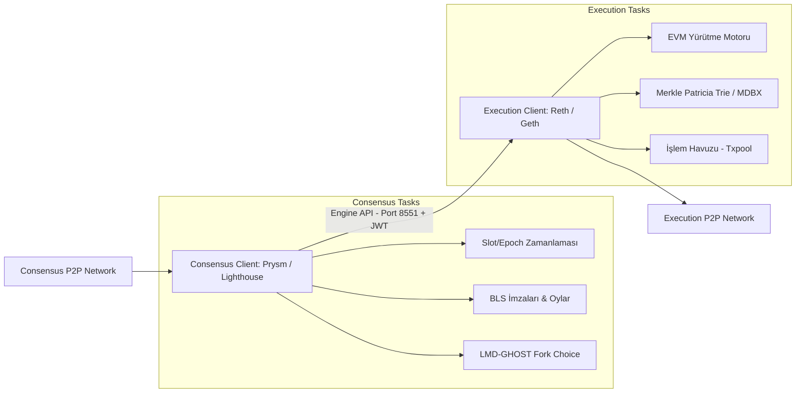

# Modül 10: İstemci Mühendisliği, Depolama Motorları & Node Operasyonu (Client Engineering & Node Operations)

Bu modül, Ethereum Execution Layer (EL) ve Consensus Layer (CL) istemcilerinin (Reth, Geth, Nethermind, Prysm, Lighthouse) iç mimarisini, Engine API iletişimini, depolama motorlarını (libmdbx, RocksDB) ve yüksek performanslı node operasyonlarını inceler.

---

## 📌 İçindekiler
1. [İstemci Mimarisi: Execution Layer vs Consensus Layer](#1-istemci-mimarisi-execution-layer-vs-consensus-layer)
2. [Engine API Haberleşmesi ve JWT Yetkilendirmesi](#2-engine-api-haberleşmesi-ve-jwt-yetkilendirmesi)
3. [Durum Veritabanları: libmdbx vs RocksDB Karşılaştırması](#3-durum-veritabanları-libmdbx-vs-rocksdb-karşılaştırması)
4. [Düğüm Senkronizasyon Modelleri (Snap Sync vs Full Archive)](#4-düğüm-senkronizasyon-modelleri-snap-sync-vs-full-archive)
5. [Engine API Mock Sunucusu](#5-engine-api-mock-sunucusu)

---

## 1. İstemci Mimarisi: Execution Layer vs Consensus Layer

---

## 2. Engine API Haberleşmesi ve JWT Yetkilendirmesi

Consensus Layer ile Execution Layer arasındaki haberleşme port `8551` üzerinde, **HS256 JWT** gizli anahtarı ile korunur.

### Temel Metotlar:
- `engine_forkchoiceUpdatedV3`: CL, EL'e mevcut baş bloğu (head), güvenli bloğu (safe) ve kesinleşmiş bloğu (finalized) bildirir. Ayrıca blok üretimi için `payloadAttributes` iletir.
- `engine_newPayloadV3`: Ağdan gelen yeni bir bloğu EL'e gönderir. EL bloğun içindeki tüm EVM işlemlerini yürütür, state root ve receipt root'ları doğrular, `VALID` / `INVALID` yanıtı döner.
- `engine_getPayloadV3`: Blok üreticisi (Proposer) rolündeki validatör için inşa edilen bloğu (`ExecutionPayloadEnvelope`) çeker.

---

## 3. Durum Veritabanları: libmdbx vs RocksDB Karşılaştırması

| Özellik | RocksDB (Geth / Erigon 1) | libmdbx (Reth / Erigon 2+) |
| :--- | :--- | :--- |
| **Veri Yapısı** | LSM-Tree (Log-Structured Merge-tree) | B+ Tree / Zero-Copy Memory Mapped Files (`mmap`) |
| **Okuma Performansı** | Düşük/Orta (Read Amplification & bloom filter aramaları) | **Ultra Hızlı** (Doğrudan RAM adresleme, sıfır kopyalama) |
| **Yazma Performansı** | Yüksek (Append-only memtable) | Orta (Page allocation & write transactions) |
| **Crash Güvenliği** | WAL (Write-Ahead Log) gerektirir | MVCC (Multi-Version Concurrency Control) ile tam ACID |
| **State Pruning** | Ağır compaction gecikmeleri yaratır | Çok düşük bellek ayak izi ve anında sayfa geri kazanımı |

---

## 4. Düğüm Senkronizasyon Modelleri (Snap Sync vs Full Archive)

1. **Full Archive Node:**
   - Genesis bloğundan bu yana her bloğun ara durumunu (state trie) saklar. Disk boyutu: ~15-20 TB.
2. **Full Node (Snap Sync / PBSS):**
   - Geçmiş blok başlıklarını ve işlemlerini doğrular ancak yalnızca en son birkaç bin bloğun durumunu saklar. Disk boyutu: ~1.5 - 2 TB.
3. **Stateless Node (Verkle / Portal Network):**
   - Blok ile gelen Verkle witness ispatlarını doğrulayarak diskte neredeyse hiçbir durum tutmadan tam doğrulama yapar.

---

## 5. Engine API Mock Sunucusu

- [`engine_api_rpc_mock.py`](./engine_api_rpc_mock.py): JWT HS256 kimlik doğrulamalı, `engine_forkchoiceUpdated` ve `engine_newPayload` çağrılarını simüle eden çalışan Python istemci motoru.
