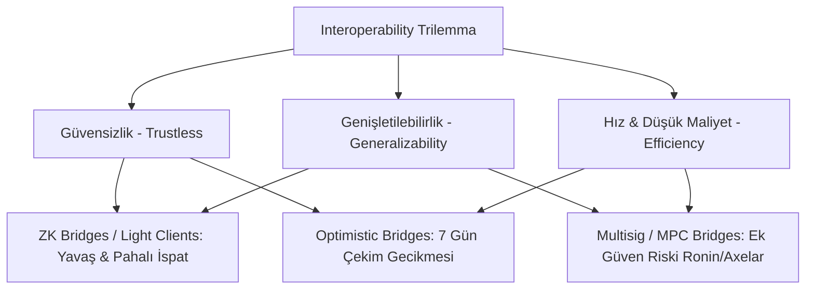

# Modül 11: Çapraz Zincir Mimarileri, Köprüler & Birlikte Çalışabilirlik (Cross-Chain Architectures & Bridges)

Bu modül, blokzincirler arası varlık ve mesaj transferlerini, köprü mimarilerini (multisig, optimistic, light client, ZK), Cosmos IBC protokolünü, LayerZero ve Chainlink CCIP standartlarını ve köprü güvenliğini inceler.

---

## 📌 İçindekiler
1. [Birlikte Çalışabilirlik Trilemması (Interoperability Trilemma)](#1-birlikte-çalışabilirlik-trilemması-interoperability-trilemma)
2. [Köprü (Bridge) Mimari Modelleri](#2-köprü-bridge-mimari-modelleri)
3. [Tarihin En Büyük Köprü Saldırıları Analizi](#3-tarihin-en-büyük-köprü-saldırıları-analizi)
4. [Cosmos IBC (Inter-Blockchain Communication) Protokolü](#4-cosmos-ibc-inter-blockchain-communication-protokolü)
5. [Modern Mesajlaşma Standartları: LayerZero & Chainlink CCIP](#5-modern-mesajlaşma-standartları-layerzero--chainlink-ccip)
6. [Simülatörler ve Referans Sözleşmeler](#6-simülatörler-ve-referans-sözleşmeler)

---

## 1. Birlikte Çalışabilirlik Trilemması (Interoperability Trilemma)

Vitalik Buterin ve Arjun Bhuptani tarafından formüle edilen trilemmaya göre bir köprü protokolü aynı anda şu üç özellikten en fazla ikisini maksimize edebilir:
1. **Güvensizlik (Trustlessness / Trust-Minimization):** Kaynak zincirin konsensüsü kadar güvenli olma; ek harici güven varsayımı (multisig, federasyon vb.) getirmeme.
2. **Genişletilebilirlik (Extensibility / Generalizability):** Herhangi bir zincire (EVM, Solana, Cosmos, Bitcoin) ve keyfi veri/durum transferine uyarlanabilirlik.
3. **Maliyet & Hız Verimliliği (Cost & Latency Efficiency):** Düşük gas maliyeti ve anlık işlem kesinliği sağlama.

---

## 2. Köprü (Bridge) Mimari Modelleri

| Model | Doğrulama Mekanizması | Örnekler | Güven Varsayımı |
| :--- | :--- | :--- | :--- |
| **Harici Doğrulamalı (MPC / Multisig)** | Bir grup doğrulayıcı özel anahtarlarıyla işlemi imzalar. | Ronin ($624M hack), Axelar, Wormhole | Doğrulayıcıların çoğunluğunun dürüst olması. |
| **İyimser (Optimistic Bridges)** | İddia zincire yazılır; itiraz penceresinde (challenge window) kanıtlanmadıkça geçerli sayılır. | Nomad ($190M hack), Connext | En az 1 dürüst izleyici (watcher) varlığı. |
| **Işık İstemci (Light Client Relayers)** | Hedef zincirdeki bir akıllı sözleşme kaynak zincirin blok başlıklarını ve konsensüsünü doğrular. | Cosmos IBC, Rainbow Bridge | Kaynak zincirin konsensüsünün güvenliği. |
| **ZK Köprüleri (Zero-Knowledge Bridges)** | Kaynak zincirin durum geçişi ZK-SNARK ile kanıtlanır; hedef zincir tek bir eşleşme kontrolü yapar. | Succinct, Polymer, Telepathy | Yalnızca matematik ve kriptografik varsayımlar. |

---

## 3. Tarihin En Büyük Köprü Saldırıları Analizi

1. **Ronin Bridge ($624M):** 9 validatörden 5'inin özel anahtarı ele geçirildi (Sosyal mühendislik / MPC sızıntısı).
2. **Wormhole Bridge ($325M):** Solana tarafındaki akıllı sözleşmede `verify_signatures` fonksiyonunun Solana sysvar hesabını sahte bir hesapla değiştiren doğrulama atlatma açığı.
3. **Nomad Bridge ($190M):** Başlatma sırasında `confirmAt[bytes32(0)] = 1` olarak ayarlanması nedeniyle kanıtlanmamış sıfır kökünün (0x00) geçerli kabul edilmesi ve herkesin rastgele baytlar göndererek fon çekebilmesi!

---

## 4. Cosmos IBC (Inter-Blockchain Communication) Protokolü

IBC, blokzincirler arası iletişimde TCP/IP standardı olarak kabul edilir:
- **Işık İstemci (Light Client):** Zincir B, Zincir A'nın başlıklarını (Tendermint validator hashlerini) takip eder.
- **Connection Handshake (4 Adım):** `ConnOpenInit` $\rightarrow$ `ConnOpenTry` $\rightarrow$ `ConnOpenAck` $\rightarrow$ `ConnOpenConfirm`.
- **Channel & Packet Flow:**
  - `SendPacket`: A zincirinde paket taahhüdü (`packetCommitment`) kaydedilir.
  - `RecvPacket`: Relayer paketi B zincirine taşır; B zincirindeki ışık istemci Merkle proof ile A zincirinde paketin var olduğunu doğrular.
  - `AcknowledgePacket`: B'nin yanıtı A'ya onay olarak iletilir.

---

## 5. Modern Mesajlaşma Standartları: LayerZero & Chainlink CCIP

- **LayerZero v2:**
  - Bağımsız DVN (Decentralized Verifier Networks) mimarisi.
  - Uygulama geliştiricisi kendi güvenlik eşiğini belirler (örn. Google Cloud DVN + Chainlink DVN + Polyhedra ZK DVN onayı).
- **Chainlink CCIP (Cross-Chain Interoperability Protocol):**
  - **Risk Management Network:** Birincil aktarma ağından tamamen bağımsız, Rust ile yazılmış ve anormal hacimleri, exploit girişimlerini anında durduran ikincil bir denetim ağı.

---

## 6. Simülatörler ve Referans Sözleşmeler

- [`contracts/CrossChainBridgeVulnerableAndSecure.sol`](./contracts/CrossChainBridgeVulnerableAndSecure.sol): Nomad tarzı sıfır kök (0x00) istismarı ve Merkle ağaçlı, imza doğrulamalı güvenli köprü sözleşmesi.
- [`ibc_light_client_sim.py`](./ibc_light_client_sim.py): Cosmos IBC 4 aşamalı bağlantı el sıkışması, paket taahhütleri ve ışık istemci doğrulama simülatörü.
