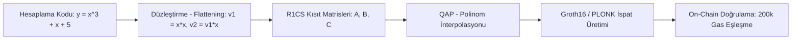

# Modül 12: Sıfır Bilgi İspatları & ZK Devre Mühendisliği (Zero-Knowledge Circuits & Arithmetization)

Bu modül, sıfır bilgi ispatlarının (Zero-Knowledge Proofs - ZKP) altında yatan matematiksel aritmetizasyon sürecini (R1CS, Plonkish, AIR), polinom taahhütlerini, lookup mekanizmalarını ve pratik ZK devre (circuit) geliştirme pratiklerini inceler.

---

## 📌 İçindekiler
1. [ZK Hesaplama Boru Hattı (Computation to SNARK Pipeline)](#1-zk-hesaplama-boru-hattı-computation-to-snark-pipeline)
2. [Aritmetizasyon: R1CS (Rank-1 Constraint Systems)](#2-aritmetizasyon-r1cs-rank-1-constraint-systems)
3. [Plonkish Aritmetizasyon ve Lookup Tabloları (Plookup & LogUp)](#3-plonkish-aritmetizasyon-ve-lookup-tabloları-plookup--logup)
4. [Modern Devre Geliştirme Dilleri: Circom, Halo2, Noir](#4-modern-devre-geliştirme-dilleri-circom-halo2-noir)
5. [Özyinelemeli İspatlar (Recursive SNARKs) & Katlama Şemaları (Nova)](#5-özyinelemeli-ispatlar-recursive-snarks--katlama-şemaları-nova)
6. [Simülatörler ve Referans Devreler](#6-simülatörler-ve-referans-devreler)

---

## 1. ZK Hesaplama Boru Hattı (Computation to SNARK Pipeline)

Klasik bir programın sıfır bilgi ispatına dönüştürülmesi ardışık matematiksel indirgemelerle gerçekleşir:

---

## 2. Aritmetizasyon: R1CS (Rank-1 Constraint Systems)

Bir R1CS, her biri en fazla **1 çarpma işlemi** içeren kısıtlar dizisidir:

$$(A \cdot s) \times (B \cdot s) = C \cdot s$$

Burada:
- $s = [1, \text{public\_inputs}, \text{private\_witness}, \text{intermediates}]$ tanık (witness) vektörüdür.
- $A, B, C$ her bir kısıt satırı için katsayı matrisleridir.
- Her satır tekil bir kısıtı temsil eder: Sol Taraf $\times$ Sağ Taraf $=$ Çıktı Tarafı.

---

## 3. Plonkish Aritmetizasyon ve Lookup Tabloları (Plookup & LogUp)

- **Standart R1CS Kısıtı:** SHA-256 veya Keccak gibi bitwise (XOR, AND, ROTR) operasyonlarda binlerce cebirsel kısıt oluşturur (her bit için bir kısıt!).
- **Lookup Argument (Plookup / LogUp / Baloo):**
  - Devre içinde işlem hesaplamak yerine önceden derlenmiş statik tablo değerleri üzerinden üyelik ispatı yapılır.
  - Örnek: 8-bit XOR tablosu hafızaya yazılır. $a \oplus b = c$ doğrulaması tek bir lookup argümanı ile sabit maliyette kanıtlanır!
  - Bu buluş, modern zkEVM'lerin (Scroll, zkSync, Polygon zkEVM) Keccak önbelleğini binlerce kat hızlandırmasını sağlamıştır.

---

## 4. Modern Devre Geliştirme Dilleri: Circom, Halo2, Noir

| Dil / Çerçeve | Ekosistem | Aritmetizasyon Modeli | Güvenilir Kurulum |
| :--- | :--- | :--- | :--- |
| **Circom** | JavaScript / SnarkJS / C++ | Saf R1CS (Groth16 / SnarkJS) | Gerekir (Powers of Tau) |
| **Halo2** | Rust (Zcash, PSE, Scroll) | Plonkish (Özel Gate'ler + Lookups) | Transparent (IPA) veya KZG |
| **Noir (Aztec)** | Rust tabanlı bağımsız dil | ACIR (Abstract Circuit Intermediate Rep.) | Backend bağımsız (Barretenberg) |
| **Gnark** | Go (Consensys / Linea) | R1CS & PLONK | Backend seçimine bağlı |

---

## 5. Özyinelemeli İspatlar (Recursive SNARKs) & Katlama Şemaları (Nova)

- **Recursive SNARK:** Bir ZK-SNARK doğrulayıcısının başka bir ZK-SNARK devresi içinde çalıştırılması ($N$ blokluk yürütmeyi tek bir ispatta toplama).
- **Nova & Folding Schemes (IVC - Incrementally Verifiable Computation):**
  - Ağır FFT (Hızlı Fourier Dönüşümü) ve MSM (Çoklu Skaler Çarpım) yapmadan, iki R1CS örneğini basit bir skaler kombinasyonla ($R_1 + r \cdot R_2$) katlama tekniğidir.
  - ZK rollup'ların yürütme izlerini saniyeler içinde doğrulamasını sağlar.

---

## 6. Simülatörler ve Referans Devreler

- [`r1cs_arithmetization_engine.py`](./r1cs_arithmetization_engine.py): Keyfi polinom denklemlerini ($y = x^3 + x + 5$) düzleştiren, $A, B, C$ matrislerini inşa eden ve $(As \circ Bs = Cs)$ tanık doğrulamasını icra eden saf Python R1CS motoru.
- [`circuits/hasher_preimage.circom`](./circuits/hasher_preimage.circom): Poseidon hash fonksiyonu ile gizli girdi (preimage) bilgisini ifşa etmeden ispatlayan üretim standardı Circom devresi.
