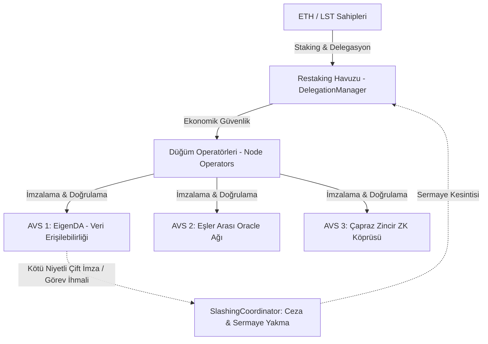

# Modül 13: Yeniden Stake Etme, Paylaşımlı Güvenlik & AVS (Restaking, Shared Security & AVS)

Bu modül; EigenLayer ve Symbiotic ile öncülük edilen **Restaking (Yeniden Stake Etme)** paradigmasını, **AVS (Actively Validated Services)** mimarisini, operatör delegasyonunu, çoklu varlık paylaşımlı güvenliğini ve zincir içi slashing (kesinti / ceza) koordinasyonunu inceler.

---

## 📌 İçindekiler
1. [Paylaşımlı Güvenlik Problemi ve Restaking Devrimi](#1-paylaşımlı-güvenlik-problemi-ve-restaking-devrimi)
2. [EigenLayer ve Symbiotic Mimari Karşılaştırması](#2-eigenlayer-ve-symbiotic-mimari-karşılaştırması)
3. [AVS (Actively Validated Services) Yaşam Döngüsü](#3-avs-actively-validated-services-yaşam-döngüsü)
4. [Slashing (Cezalandırma) Mekaniği ve Kaskat Riskler](#4-slashing-cezalandırma-mekaniği-ve-kaskat-riskler)
5. [Simülatörler ve Referans Sözleşmeler](#5-simülatörler-ve-referans-sözleşmeler)

---

## 1. Paylaşımlı Güvenlik Problemi ve Restaking Devrimi

Geleneksel Web3 altyapısında her yeni oracle ağı, köprü (bridge), veri erişilebilirlik (DA) katmanı veya yan zincir kendi bağımsız validatör kümesini ve kendi yerel tokenını (PoS) sıfırdan oluşturmak zorundaydı. Bu durum iki temel problem yaratıyordu:
1. **Sermaye Verimsizliği (Capital Inefficiency):** Her ağ için milyarlarca dolarlık yeni sermaye bağlanması gerekiyordu.
2. **Düşük Ekonomik Güvenlik:** Yeni başlayan protokollerin sermaye derinliği sığ olduğu için $51\%$ saldırı maliyeti son derece düşüktü.

**Restaking Paradigması:** Ethereum L1 üzerinde kilitli olan 30+ milyon ETH'lik devasa ekonomik güvenlik havuzunun, para çekme kimlik bilgilerini (`withdrawal_credentials`) bir akıllı sözleşmeye yönlendirerek (Native Restaking) veya LST/LRT tokenları (stETH, rETH) kilitleyerek ikincil hizmetlere (AVS) kiralanmasıdır.

---

## 2. EigenLayer ve Symbiotic Mimari Karşılaştırması

| Kriter | EigenLayer | Symbiotic |
| :--- | :--- | :--- |
| **Temel Odak** | Ethereum merkezli (Native ETH + ERC-20 LST) | İznisiz ve Her Varlıkla Uyumlu (Herhangi bir ERC-20 / LP Token) |
| **Slashing Modeli** | Merkezi koordinasyon ve aşamalı veto komitesi | Modüler, izole kural motorları ve özel Resolver sözleşmeleri |
| **Kullanıcı Yetkilendirmesi** | Tekil operatör delegasyonu | Çoklu operatör ve alt-ağlara granüler sermaye tahsisi |
| **Sözleşme Mimarisi** | Core Strategy Manager & DelegationManager | Minimalist çekirdek (Vaults, Resolvers, Networks) |

---

## 3. AVS (Actively Validated Services) Yaşam Döngüsü

1. **Görev Oluşturma (Task Creation):** AVS koordinatör sözleşmesi yeni bir iş yükü (örneğin veri bloğu taahhüdü veya oracle fiyat konsensüsü) yayımlar.
2. **Görev İcrası (Task Execution):** Kayıtlı operatörler iş yükünü zincir dışında hesaplar ve BLS/ECDSA imzası ile onaylar.
3. **Korum Konsensüsü (Quorum Aggregation):** Toplam stake ağırlığının en az $\%66.7$'sinin (süper çoğunluk) onay imzası toplandığında görev tamamlanmış sayılır.
4. **Ödül & Ceza:** Başarılı görevler stake sahiplerine getiri (`yield`) kazandırırken, geçersiz veri imzalayan operatörler `slashing` sürecine tabi tutulur.

---

## 4. Slashing (Cezalandırma) Mekaniği ve Kaskat Riskler

- **Objektif Slashing:** Matematiksel olarak zincir üstünde tek bir işlemde ispatlanabilen hatalar (örneğin aynı blok numarası için iki farklı hash imzalamak - double signing).
- **Subjektif Hatalar:** Ağ gecikmesi, veri gizleme veya zincir üstünde anında doğrulanamayan durumlar. Sosyal konsensüs veya merkeziyetsiz jüri kurulları gerektirir.
- **Kaskat Risk (Cascading Contagion):** Aynı operatörün aynı 10,000 ETH ile 5 farklı AVS'yi güvenceye alması durumunda; AVS'lerden birinde gerçekleşen bir ceza kesintisi, operatörün diğer 4 AVS'deki minimum teminat eşiğini düşürerek zincirleme tasfiyeleri tetikleyebilir.

---

## 5. Simülatörler ve Referans Sözleşmeler

- [`contracts/AVSSlashingCoordinator.sol`](./contracts/AVSSlashingCoordinator.sol): Üretim seviyesi AVS görev koordinatörü; operatör delegasyonu, kuorum doğrulaması ve dondurma/kesinti mekanizması.
- [`eigenlayer_restaking_sim.py`](./eigenlayer_restaking_sim.py): Çoklu AVS paylaşımı, ağırlıklı kuorum konsensüsü ve kaskat slashing riski simülatörü.
