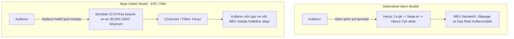

# Modül 14: Niyet Odaklı Mimariler, Çözücüler & ERC-7683 (Intent-Centric Architectures, Solvers & ERC-7683)

Bu modül; geleneksel "işlem yürütme" (imperative transactions) modelinden **"niyet odaklı" (declarative intents)** modele geçişi, UniswapX ve Across tarafından ortaklaşa geliştirilen **ERC-7683 Çapraz Zincir Niyet Standardı**'nı, Hollanda Açık Artırması (Dutch Auction) fiyatlandırmasını ve Çözücü (Solver/Filler) pazar mekaniğini inceler.

---

## 📌 İçindekiler
1. [İşlem (Transaction) vs Niyet (Intent) Paradigması](#1-i̇şlem-transaction-vs-niyet-intent-paradigması)
2. [ERC-7683: Çapraz Zincir Niyet Standardı](#2-erc-7683-çapraz-zincir-niyet-standardı)
3. [Hollanda Açık Artırması (Dutch Auction) Fiyat Azalma Eğrisi](#3-hollanda-açık-artırması-dutch-auction-fiyat-azalma-eğrisi)
4. [Çözücü (Solver) Ekonomisi ve CoW (Coincidence of Wants) Eşleşmesi](#4-çözücü-solver-ekonomisi-ve-cow-coincidence-of-wants-eşleşmesi)
5. [Simülatörler ve Referans Sözleşmeler](#5-simülatörler-ve-referans-sözleşmeler)

---

## 1. İşlem (Transaction) vs Niyet (Intent) Paradigması



| Özellik | Geleneksel İşlem (Imperative) | Niyet Modeli (Declarative Intent) |
| :--- | :--- | :--- |
| **Yürütme Yolu** | Kullanıcı / dApp tarafından önceden katı belirlenir. | Çözücü (Solver) en uygun zincir üstü/altı yolu bulur. |
| **Gaz Maliyeti** | İşlem başarısız olsa bile kullanıcı gaz öder. | Başarısızlık durumunda kullanıcının cebinden gaz çıkmaz. |
| **MEV Koruması** | Genel mempool'da açık hedef haline gelir. | Özel sipariş akışıyla çözücüler tarafından korunur. |
| **Çapraz Zincir** | Köprüler, wrapped tokenlar ve çoklu adımlı onaylar gerekir. | Kullanıcı A zincirinde imzalar, B zincirinde anında fon alır. |

---

## 2. ERC-7683: Çapraz Zincir Niyet Standardı

ERC-7683, çapraz zincir emirlerinin tüm köprüler ve çözücüler tarafından ortak bir formatta okunmasını sağlar:

```solidity
struct CrossChainOrder {
    address settlementContract;
    address swapper;
    uint256 nonce;
    uint32 originChainId;
    uint32 initiateDeadline;
    uint32 fillDeadline;
    bytes orderData; // Çıkış tokenı, hedef zincir, minimum miktar
}
```

- **Origin Settler:** Kaynak zincirde kullanıcının fonlarını kilitler veya emanete (`escrow`) alır.
- **Destination Settler:** Çözücü hedef zincirde kendi sermayesiyle kullanıcıya ödeme yapar (`fillOrder`) ve kanıtı kaynak zincire sunarak teminatı çözer.

---

## 3. Hollanda Açık Artırması (Dutch Auction) Fiyat Azalma Eğrisi

UniswapX ve modern niyet motorlarında, çözücülerin kullanıcıya vereceği çıktı miktarı zamanla doğrusal olarak azalır:

$$\text{Output}(t) = \text{StartAmount} - \left( \frac{t - t_{\text{start}}}{t_{\text{end}} - t_{\text{start}}} \right) \times (\text{StartAmount} - \text{EndAmount})$$

- Başlangıçta kullanıcı lehine piyasa üstü bir fiyat teklif edilir.
- En verimli algoritmaya, en derin özel likiditeye veya en düşük gaz maliyetine sahip çözücü, kâr marjı sıfıra yaklaşmadan önce emri anında doldurur.

---

## 4. Çözücü (Solver) Ekonomisi ve CoW (Coincidence of Wants) Eşleşmesi

- **CoW Swap:** Eğer Alice 10 ETH satıp 30,000 USDC almak istiyorsa, Bob da 30,000 USDC satıp 10 ETH almak istiyorsa; çözücü bu iki emri hiçbir AMM havuzuna gitmeden, sıfır kayma (slippage) ve sıfır LP komisyonuyla doğrudan eşleştirir.
- **Envanter Arbitrajı:** Çözücüler CEX (Binance, Coinbase) veya L2 ağlarındaki kendi envanterlerini kullanarak zincirler arası anlık takasları finanse eder.

---

## 5. Simülatörler ve Referans Sözleşmeler

- [`contracts/ERC7683CrossChainSettler.sol`](./contracts/ERC7683CrossChainSettler.sol): ERC-7683 uyumlu Origin Escrow ve Destination Settler akıllı sözleşmesi; EIP-712 niyet doğrulaması ve çözücü geri ödeme mekanizması.
- [`intent_solver_auction_sim.py`](./intent_solver_auction_sim.py): Hollanda açık artırması fiyat azalımı, çoklu çözücü rekabeti ve CoW eşleşme simülatörü.
