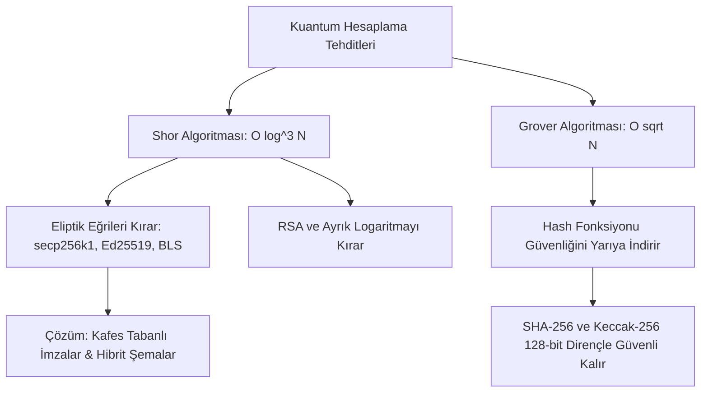

# Modül 15: Kuantum Sonrası Kriptografi & Hibrit Durum Makineleri (Post-Quantum Cryptography & Hybrid State Machines)

Bu modül; kuantum bilgisayarlarının modern blokzincirler için oluşturduğu varoluşsal tehditleri, Shor ve Grover algoritmalarını, kafes tabanlı (Lattice-Based) NIST FIPS standartlarını (ML-DSA / Dilithium, ML-KEM / Kyber) ve hesap soyutlama (ERC-4337) üzerinden hibrit imza geçiş stratejilerini inceler.

---

## 📌 İçindekiler
1. [Kuantum Tehdit Modeli: Shor ve Grover Algoritmaları](#1-kuantum-tehdit-modeli-shor-ve-grover-algoritmaları)
2. [Kafes Tabanlı Kriptografi (Lattice-Based Cryptography)](#2-kafes-tabanlı-kriptografi-lattice-based-cryptography)
3. [NIST FIPS 203 / 204 Standartları (ML-KEM & ML-DSA)](#3-nist-fips-203--204-standartları-ml-kem--ml-dsa)
4. [Hesap Soyutlama ile Hibrit (Hybrid) İmza Geçiş Mimarisi](#4-hesap-soyutlama-ile-hibrit-hybrid-imza-geçiş-mimarisi)
5. [Simülatörler ve Referans Kodlar](#5-simülatörler-ve-referans-kodlar)

---

## 1. Kuantum Tehdit Modeli: Shor ve Grover Algoritmaları

### Shor Algoritması:
- Ayrık Logaritma Problemini (DLP) ve Çarpanlara Ayırmayı polinom zamanda çözer.
- Bitcoin ve Ethereum'un kullandığı `secp256k1` eliptik eğri özel anahtarı, genel anahtardan (public key) kolayca türetilebilir hale gelir.
- **Kamuya Açık Adres Riski:** Genel anahtarı zincirde ifşa edilmiş (daha önce en az 1 işlem göndermiş) tüm hesaplar fon kaybı riskiyle karşı karşıya kalır.

### Grover Algoritması:
- Kriptografik hash fonksiyonlarında arama uzayını karekök hızına indirir ($2^{256} \rightarrow 2^{128}$).
- 256-bitlik modern hash fonksiyonları (Keccak-256, SHA-256, Poseidon) kuantum sonrası dönemde de güvenliğini korur.

---

## 2. Kafes Tabanlı Kriptografi (Lattice-Based Cryptography)

Kuantum bilgisayarlarının dahi çözemediği kabul edilen yüksek boyutlu geometri ve lineer cebir problemlerine dayanır:
- **Shortest Vector Problem (SVP):** Çok boyutlu bir kafeste orijine en yakın sıfır olmayan vektörü bulma zorluğu.
- **Learning With Errors (LWE / Ring-LWE / Module-LWE):**
  $$A \cdot s + e \equiv b \pmod q$$
  Burada $A$ matris, $s$ gizli anahtar vektörü, $e$ küçük rastgele hata (gürültü) vektörüdür. Gürültü ($e$) eklendiğinde lineer denklem sistemini çözmek NP-zor kabul edilir.

---

## 3. NIST FIPS 203 / 204 Standartları (ML-KEM & ML-DSA)

1. **ML-KEM (Module-Lattice Key Encapsulation Mechanism - Eski adıyla Kyber - FIPS 203):**
   - Kuantum sonrası anahtar değişimi ve gizli şifreleme standardı.
2. **ML-DSA (Module-Lattice Digital Signature Algorithm - Eski adıyla Dilithium - FIPS 204):**
   - Blokzincir işlemleri ve akıllı sözleşme doğrulaması için kuantum sonrası dijital imza standardı.
   - İmzalar geleneksel ECDSA (64 bayt) imzalarına göre daha büyüktür (~2.4 KB ile 4.5 KB).

---

## 4. Hesap Soyutlama ile Hibrit (Hybrid) İmza Geçiş Mimarisi

Blokzincirlerin kuantum tehdidine karşı bir gecede çatallanması (hard fork) yıkıcı olabilir. Bunun yerine **ERC-4337 Hesap Soyutlama** üzerinden hibrit model uygulanır:

$$\text{ValidSignature} = \text{Verify}_{\text{ECDSA}}(m, \sigma_1, \text{PK}_{\text{ECDSA}}) \land \text{Verify}_{\text{Lattice}}(m, \sigma_2, \text{PK}_{\text{Lattice}})$$

- Kuantum bilgisayarı ECDSA'yı kırsa dahi, kafes tabanlı imza sahteciliği engelleyerek kullanıcı fonlarını tam güvende tutar.

---

## 5. Simülatörler ve Referans Kodlar

- [`post_quantum_lattice_signatures.py`](./post_quantum_lattice_signatures.py): Modüler kafes halka aritmetiği, LWE anahtar üretimi, gürültü ekleme, red örneklemesi (rejection sampling) ve ECDSA + Kafes hibrit imza doğrulama motoru.
